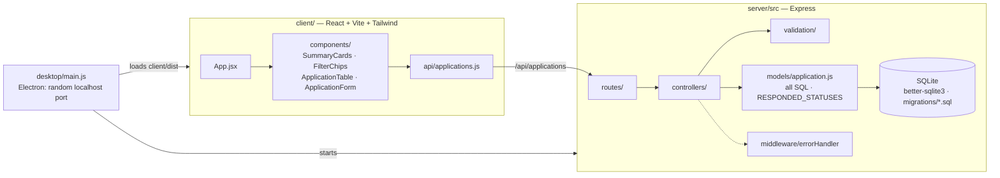

# Internship Application Tracker

A single-user CRUD app for tracking internship applications.
React + Vite + Tailwind on the front, Node + Express + SQLite (better-sqlite3) on the back.

## Run it

Requires Node 20+ (developed on Node 22).

```bash
npm install                       # root (concurrently)
npm install --prefix server
npm install --prefix client

npm run seed                      # optional: 8 sample applications
npm run dev                       # API on :3001, app on http://localhost:5173
```

The database is created automatically at `server/data/tracker.db` and migrations run on server start.
`npm run seed` refuses to run on a non-empty table; use `npm run seed -- --force` to add samples anyway.
To start over, stop the server and delete `server/data/tracker.db`.

| Command | What it does |
| --- | --- |
| `npm run dev` | Server (auto-restart) and client together |
| `npm run migrate` | Apply pending migrations |
| `npm run seed` | Insert sample data |
| `npm run build --prefix client` | Production build of the client |

Env vars: `PORT` (default 3001), `DB_PATH` (default `server/data/tracker.db`).

## Desktop app (macOS)

The same app packaged with Electron. The window runs the Express server on a random localhost-only port,
so nothing is exposed to the network.

```bash
npm install --prefix desktop
npm run dist        # builds client, packages, writes desktop/release/Internship Tracker-<version>-arm64.dmg
npm run desktop     # or: run the desktop app without packaging
```

- Open the `.dmg`, drag **Internship Tracker** to Applications.
- Data is stored in `~/Library/Application Support/Internship Tracker/tracker.db`. Back it up by copying that file.
- Builds are signed with whatever Apple Development certificate is on your Mac, not notarized. On another Mac,
  Gatekeeper will block it until you right-click → Open (or notarize with a paid Developer ID).
- The dev setup (`npm run dev`) uses `server/data/tracker.db`, a separate database from the desktop app.

## API

Base path `/api/applications`. Errors always look like `{ "error": { "message": "...", "details": { field: "..." } } }`.

| Method | Path | Notes |
| --- | --- | --- |
| GET | `/` | Optional `?status=interview`. Invalid status → 400 |
| GET | `/stats` | `total`, `interviewing`, `responded`, `response_rate` (0–1) |
| GET | `/:id` | 404 if missing, 400 if id isn't a positive integer |
| POST | `/` | `company`, `role_title`, `status` required. 201 + `Location` header; 422 with per-field `details` |
| PATCH | `/:id` | Partial update; 200, 404, 422, or 400 for an empty body |
| DELETE | `/:id` | 204, or 404 |

Validation: dates must be real `YYYY-MM-DD` dates, `job_url` must be http(s), strings are trimmed and
empty optional strings are stored as `null`.

**Response rate** = applications with status `online_assessment`, `interview`, `offer` or `rejected`
÷ total. `withdrawn` is excluded because it's your decision, not the company's response.
It's defined in one place: `RESPONDED_STATUSES` in `server/src/models/application.js`.

## Structure

```
server/src/
  index.js, app.js        # startup / Express app (auth middleware goes in app.js)
  config.js
  db/                     # connection, migrate.js, migrations/*.sql, seed.js
  models/application.js   # JSDoc typedefs + all SQL
  validation/             # request validation
  controllers/, routes/   # thin HTTP layer
  middleware/             # error handling
desktop/                  # Electron wrapper: main.js + packaging (copies server/ and client/dist)
client/src/
  api/                    # fetch wrapper
  components/             # table, badges, chips, form, summary cards
  constants/status.js     # status labels and colors (single source on the client)
```

## Data model and extending it

The `applications` table is documented with JSDoc in `server/src/models/application.js`.
Designed so later features are additive:

- **Gmail sync:** `gmail_thread_id` already exists with a unique partial index, so sync can upsert by thread.
  Message history can go in a new `application_events` table without touching `applications`.
- **Reminders:** `follow_up_date` is indexed; a reminder job is a query on it. Richer reminders can be a new table.
- **Auth:** add `app.use('/api', requireAuth)` in `server/src/app.js`; add a `user_id` column via a new migration.
- **Schema changes:** add `server/src/db/migrations/002_*.sql`; it's applied automatically on next start.
  Adding a status means a new migration (SQLite can't alter a CHECK, so rebuild the table) plus `constants/status.js`.

## Architecture

The same Express API serves the browser build in development and the Electron window in the desktop app.



| Path | Purpose |
|---|---|
| `client/src/App.jsx` | Page state: list, filter and form |
| `client/src/components/` | Summary cards, filter chips, table, form, status badge and select |
| `client/src/api/applications.js` | Fetch wrapper for `/api/applications` |
| `client/src/constants/status.js` | The status list shared by the UI |
| `server/src/app.js`, `index.js`, `config.js` | Express app, startup, env (`PORT`, `DB_PATH`) |
| `server/src/routes/`, `controllers/` | Thin HTTP layer |
| `server/src/validation/application.js` | Request validation with per-field errors (422) |
| `server/src/models/application.js` | Typedefs, every SQL statement, and `RESPONDED_STATUSES` |
| `server/src/db/` | Connection, `migrate.js`, `migrations/*.sql`, `seed.js` |
| `server/src/middleware/errorHandler.js` | Maps errors to the `{ error: { message, details } }` shape |
| `desktop/` | Electron wrapper; `scripts/prepare.js` copies `server/` and `client/dist` for packaging |

## Design patterns

- **Layered server: route → controller → model.** Controllers stay thin; SQL lives only in the model.
- **Validate, then persist.** Input is trimmed and checked before it reaches the model, and failures come back as one consistent
  error body.
- **Single definition of a business rule.** "Responded" is `RESPONDED_STATUSES` in one place; stats and the UI both depend on it.
- **Versioned SQL migrations** applied on start, so a fresh install and an upgrade follow the same path.
- **Same server, two shells.** The desktop build runs the unchanged Express app on a random localhost-only port instead of
  re-implementing storage.
- **Auth seam.** `app.js` is the one place middleware would be added if the app ever becomes multi-user.
